# Three-signal nonlinear interdependence: performance on simulated data

How well pairwise M, conditional M and partial cross mapping recover the known links of the 2018 coupled-oscillator model, measured as sensitivity, specificity, precision, F1, accuracy, area under the curve, power curves and detection maps, all recomputed from per-seed results.

## Contents

- [What was run](#what-was-run)
- [Definitions: methods and measures](#definitions-methods-and-measures)
  - [Time-delay embedding](#time-delay-embedding)
  - [The M index](#the-m-index)
  - [Pairwise M](#pairwise-m)
  - [Conditional M](#conditional-m)
  - [Partial cross mapping](#partial-cross-mapping)
  - [The time-shift surrogate test](#the-time-shift-surrogate-test)
  - [Present and absent links](#present-and-absent-links)
  - [Performance measures](#performance-measures)
- [Overall performance](#overall-performance)
- [Confusion matrices](#confusion-matrices)
- [By breathing frequency](#by-breathing-frequency)
- [By link direction](#by-link-direction)
- [Detection map by scenario](#detection-map-by-scenario)
- [Power curves](#power-curves)
- [Where the false positives come from](#where-the-false-positives-come-from)
- [Receiver operating characteristic](#receiver-operating-characteristic)
- [Index and p-value distributions](#index-and-p-value-distributions)
- [Why pupil to attention is the weak link: frequency swap test](#why-pupil-to-attention-is-the-weak-link-frequency-swap-test)
- [Telling direction: the joint-embedding forecast (prediction gain)](#telling-direction-the-joint-embedding-forecast-prediction-gain)
- [Full joint-embedding forecast (nine dimensions)](#full-joint-embedding-forecast-nine-dimensions)
- [Dynamical Bayesian inference of phase coupling](#dynamical-bayesian-inference-of-phase-coupling)
- [Caveats and provenance](#caveats-and-provenance)

## What was run

| Setting | Value |
| --- | --- |
| **Model** | Three coupled phase oscillators from Melnychuk et al. 2018, Equation 2: attention, locus coeruleus (read out as pupil diameter) and respiration |
| **Scenarios** | Published model (four links through the locus coeruleus, no direct breathing–attention link); the same with the direct link added both ways (all six links); every coupling at zero |
| **Breathing rates** | 0.12, 0.25 and 0.35 Hz, coupling 0.45 at 0.12 Hz and 0.33 otherwise (2018 Figure 5) |
| **Coupling sweep** | One directed link on at a time, coupling 0 to 0.90, others zero, 0.25 Hz, 120 s |
| **Seeds and test** | Seeds 0–19, 19 time-shift surrogates, a link counts as detected when its index is positive and p ≤ 0.05 |
| **Tests scored** | 1,080 per method in the scenarios and 5,040 per method in the sweep |

I reran the branch code on my computer with exactly these settings and kept every per-seed index value and p-value. The rerun reproduces the counts the cloud agent reported to the seed, so everything below comes from raw results, not from the headline numbers.

## Definitions: methods and measures

These describe what the branch code actually computes, checked against `sniff_sync/nlid/measures.py`, `sniff_sync/nlid/pcm.py`, `sniff_sync/nlid/analyze.py` and `docs/nonlinear_interdependence.md`. Throughout, X is the candidate source, Y the target and Z the third (conditioning) signal.

### Time-delay embedding

Each signal is first standardised to a mean of 0 and a standard deviation of 1. Each moment is then turned into a point in a small state space by stacking the current sample with earlier samples of the same signal, which is Takens' delay embedding. In these simulations every signal used three samples spaced a quarter of a breathing cycle apart, so each moment is a point in three-dimensional space. On real recordings the code picks the delay from the first minimum of the mutual information and the dimension from the false-nearest-neighbour fraction instead.

Neighbour searches skip a Theiler window, here one breathing cycle, so a state is never matched with samples from its own immediate past. Without that, every state would look like its own neighbour simply because the signal is smooth.

### The M index

M comes from Andrzejak and colleagues (2003). For each moment, the code takes the target's state and measures three average squared distances, all in the target's own state space. The first is the distance to the target's own 8 nearest neighbours, which is as close as it can get. The second is the distance to the target states at the times of the source's 8 nearest neighbours. The third is the distance to all other states, which is what picking times at random would give.

$$
M = \text{average over moments of } \frac{R(Y) - R(Y \mid X)}{R(Y) - R_k(Y)}
$$

Here R(Y) is the distance to all states, R(Y | X) the distance at the source's neighbour times and R_k(Y) the distance to the target's own neighbours. M near 0 means the source's neighbours are no better than random times, so the source says nothing about the target's state. M near 1 means the source's neighbours are the target's own neighbours. The arrow X→Y means that the source's neighbours predict the target's state. On its own that is a statement about predictability, not proof of which oscillator drives which.

### Pairwise M

Pairwise M is the M index above applied to two signals at a time, source to target, giving one value for each of the six ordered pairs. It looks at nothing else. It therefore cannot tell a direct link from one that passes through the third signal. In the published model, breathing and attention are both locked to the locus coeruleus, so their states line up and pairwise M reports a breathing–attention dependence even though there is no direct term between them.

### Conditional M

Conditional M asks whether the source still helps once the third signal has been taken into account. For each moment the code takes a pool of the 40 nearest neighbours in the conditioning signal Z. From that pool it cuts two sets of 8. One set is simply the 8 closest in Z. The other is the 8 pool members whose source X is closest to the current source state, so the pool is re-ranked by the source. It then measures how close the target Y is under each set.

$$
\text{conditional } M = \text{average over moments of } \frac{R(Y \mid Z) - R(Y \mid X; Z)}{R(Y \mid Z) - R_k(Y)}
$$

Here R(Y | Z) is the target distance using the conditioner-only set, R(Y | X; Z) is the distance using the re-ranked set, and R_k(Y) is the distance to the target's own neighbours. Zero means that once states are matched on the third signal, matching the source as well does not bring the target any closer, which is what you expect when the only route is through the third signal. A positive value means the source carries information about the target that the third signal does not, which is the test for a direct link given the third signal. The pool is built from the conditioning signal alone, not from a joint embedding of target and conditioner. The code also has a joint-embedding forecast version, called prediction gain, but it is not used anywhere on this page. Re-ranking inside a pool, rather than adding the source as extra dimensions, stops an irrelevant source from scrambling the neighbours.

### Partial cross mapping

Partial cross mapping comes from Leng and colleagues (2020, Nature Communications) and builds on convergent cross mapping from Sugihara and colleagues (2012). The idea is that if X influences Y, Y's state space carries a trace of X, so Y's nearest neighbours (dimension plus one of them, weighted by distance) can estimate X. Cross-mapping X from Y at its best time lag gives everything Y knows about X. That estimate also lights up for an indirect link, because the third signal's trace is copied onward.

To remove the indirect route, the code first cross-maps Z from Y, which is the trace of Z visible in Y, and then cross-maps X from that trace, which is the part of X that Y knows only through Z. The direct-link index is the absolute partial correlation between X and its direct estimate, after the indirect estimate has been partialled out.

$$
\text{direct-link index} = \frac{\left| r(x, \text{direct}) - r(x, \text{indirect}) \cdot r(\text{direct}, \text{indirect}) \right|}{\sqrt{\left(1 - r(x, \text{indirect})^{2}\right)\left(1 - r(\text{direct}, \text{indirect})^{2}\right)}}
$$

Near 0 means Y's knowledge of X is explained by the third signal. Larger values mean a remainder the third signal does not explain. Because it is an absolute value it is never negative, so a detection rests on the surrogate test alone. Leng and colleagues warn that the method is not meant for strongly synchronised systems, which is relevant once oscillators phase-lock.

### The time-shift surrogate test

To ask whether an index is bigger than chance, the code rotates the source signal in time by a random amount between 15% and 50% of the recording, and at least one Theiler window plus one sample, and recomputes the index. Rotating keeps the source's shape and rhythm but breaks its timing with the other two signals, which stay as they are. This is done with 19 different shifts. The p-value is one plus the number of surrogates that score at least as high as the real data, divided by 20, so the smallest possible value is 0.05 and it moves in steps of 0.05. A link counts as detected when p ≤ 0.05, meaning the real index beat all 19 surrogates, and the index is positive.

### Present and absent links

A link is present when its directed coupling coefficient in the simulated equations is above zero, and absent when it is zero. Absent means there is no direct term, even if the two signals are related indirectly or in the other direction.

In the scenarios, the published model has four links present (breathing to and from the locus coeruleus, and the locus coeruleus to and from attention), with breathing→attention and attention→breathing absent. The all-six-links scenario adds those two, so all six are present. The uncoupled scenario has all six absent. In the sweep, each run switches on one directed link at a chosen coupling, and that direction is present while the other five are absent. At coupling 0 all six are absent.

In the published model, breathing and attention still move together through the locus coeruleus, so a pairwise method that reports that link is seeing a real but indirect dependence. It is scored as a false positive because the question is whether a method finds direct links only.

### Performance measures

| Measure | Definition |
| --- | --- |
| Sensitivity (true positive rate, power) | Of the links that really exist, the share the method detects. |
| False-positive rate | Of the links that do not exist, the share the method still reports. One minus this is specificity. |
| Precision (positive predictive value) | Of the links the method reports, the share that really exist. It depends on how many links are present, so it is not comparable between the scenarios and the sweep. |
| F1 | The harmonic mean of precision and sensitivity, one number that punishes both missed and invented links. |
| Accuracy and balanced accuracy | Accuracy is the share of all calls that are right. Balanced accuracy averages sensitivity and specificity, so it is not inflated when absent links outnumber present ones, as in the sweep. |
| Area under the curve | Ranks tests by the raw index value, ignoring the surrogate test. 1 means every present link scores above every absent one, 0.5 is chance. |
| Wilson 95% interval | The range in brackets after a rate, a confidence interval that behaves well with small counts such as 20 seeds. |

## Overall performance

### Three scenarios

| Method | Sensitivity | False-positive rate | Specificity | Precision | F1 | Accuracy | Balanced accuracy | Area under curve |
| --- | --- | --- | --- | --- | --- | --- | --- | --- |
| Pairwise M | 1.00 (0.99–1.00) | 0.30 (0.26–0.34) | 0.70 | 0.81 (0.78–0.83) | 0.89 | 0.87 (0.85–0.89) | 0.85 | 0.990 (0.986–0.993) |
| Conditional M | 0.83 (0.80–0.86) | 0.01 (0.00–0.02) | 0.99 | 0.99 (0.98–1.00) | 0.91 | 0.90 (0.88–0.92) | 0.91 | 0.976 (0.967–0.984) |
| Partial cross mapping | 1.00 (0.99–1.00) | 0.26 (0.22–0.30) | 0.74 | 0.83 (0.80–0.85) | 0.90 | 0.88 (0.86–0.90) | 0.87 | 0.995 (0.992–0.997) |

### Coupling sweep

| Method | Sensitivity | False-positive rate | Specificity | Precision | F1 | Accuracy | Balanced accuracy | Area under curve |
| --- | --- | --- | --- | --- | --- | --- | --- | --- |
| Pairwise M | 0.81 (0.78–0.84) | 0.20 (0.19–0.21) | 0.80 | 0.40 (0.38–0.43) | 0.54 | 0.80 (0.79–0.81) | 0.81 | 0.858 (0.843–0.873) |
| Conditional M | 0.76 (0.73–0.79) | 0.14 (0.13–0.16) | 0.86 | 0.47 (0.44–0.49) | 0.58 | 0.84 (0.83–0.85) | 0.81 | 0.863 (0.848–0.876) |
| Partial cross mapping | 0.79 (0.76–0.82) | 0.18 (0.17–0.19) | 0.82 | 0.42 (0.39–0.45) | 0.55 | 0.81 (0.80–0.83) | 0.80 | 0.840 (0.823–0.856) |

In the three scenarios the conditional measure trades sensitivity for specificity: it misses about one true link in six but makes only 4 false calls in 480, against 144 for pairwise M and 125 for partial cross mapping. In the sweep all three lose specificity and their F1 scores fall to 0.54–0.58, for a reason shown further down.

## Confusion matrices

### Three scenarios

#### Pairwise M

|  | Link present | Link absent |
| --- | --- | --- |
| Detected | 600 true positives | 144 false positives |
| Not detected | 0 false negatives | 336 true negatives |

#### Conditional M

|  | Link present | Link absent |
| --- | --- | --- |
| Detected | 500 true positives | 4 false positives |
| Not detected | 100 false negatives | 476 true negatives |

#### Partial cross mapping

|  | Link present | Link absent |
| --- | --- | --- |
| Detected | 599 true positives | 125 false positives |
| Not detected | 1 false negatives | 355 true negatives |

### Coupling sweep

#### Pairwise M

|  | Link present | Link absent |
| --- | --- | --- |
| Detected | 584 true positives | 865 false positives |
| Not detected | 136 false negatives | 3455 true negatives |

#### Conditional M

|  | Link present | Link absent |
| --- | --- | --- |
| Detected | 546 true positives | 626 false positives |
| Not detected | 174 false negatives | 3694 true negatives |

#### Partial cross mapping

|  | Link present | Link absent |
| --- | --- | --- |
| Detected | 568 true positives | 782 false positives |
| Not detected | 152 false negatives | 3538 true negatives |

## By breathing frequency

| Method | Breathing | TP / FP / TN / FN | Sensitivity | False-positive rate | Precision | F1 | Balanced accuracy | Area under curve |
| --- | --- | --- | --- | --- | --- | --- | --- | --- |
| Pairwise M | 0.12 Hz | 200 / 50 / 110 / 0 | 1.00 (0.98–1.00) | 0.31 (0.25–0.39) | 0.80 | 0.89 | 0.84 | 1.000 |
| Pairwise M | 0.25 Hz | 200 / 46 / 114 / 0 | 1.00 (0.98–1.00) | 0.29 (0.22–0.36) | 0.81 | 0.90 | 0.86 | 0.996 |
| Pairwise M | 0.35 Hz | 200 / 48 / 112 / 0 | 1.00 (0.98–1.00) | 0.30 (0.23–0.38) | 0.81 | 0.89 | 0.85 | 0.994 |
| Conditional M | 0.12 Hz | 174 / 0 / 160 / 26 | 0.87 (0.82–0.91) | 0.00 (0.00–0.02) | 1.00 | 0.93 | 0.94 | 0.997 |
| Conditional M | 0.25 Hz | 163 / 2 / 158 / 37 | 0.81 (0.76–0.86) | 0.01 (0.00–0.04) | 0.99 | 0.89 | 0.90 | 0.975 |
| Conditional M | 0.35 Hz | 163 / 2 / 158 / 37 | 0.81 (0.76–0.86) | 0.01 (0.00–0.04) | 0.99 | 0.89 | 0.90 | 0.957 |
| Partial cross mapping | 0.12 Hz | 200 / 48 / 112 / 0 | 1.00 (0.98–1.00) | 0.30 (0.23–0.38) | 0.81 | 0.89 | 0.85 | 1.000 |
| Partial cross mapping | 0.25 Hz | 200 / 39 / 121 / 0 | 1.00 (0.98–1.00) | 0.24 (0.18–0.32) | 0.84 | 0.91 | 0.88 | 0.997 |
| Partial cross mapping | 0.35 Hz | 199 / 38 / 122 / 1 | 0.99 (0.97–1.00) | 0.24 (0.18–0.31) | 0.84 | 0.91 | 0.88 | 0.995 |

Three scenarios pooled, 360 tests per row (TP, FP, TN and FN are true positives, false positives, true negatives and false negatives). Breathing rate barely matters for the two pairwise-style methods. The conditional measure does best at 0.12 Hz, with no false calls at all, probably because the coupling is larger there (0.45 against 0.33).

## By link direction

### Three scenarios

#### Pairwise M

| Link | TP / FP / TN / FN | Sensitivity | False-positive rate | Precision | F1 | Balanced accuracy | Area under curve |
| --- | --- | --- | --- | --- | --- | --- | --- |
| breathing→pupil | 120 / 4 / 56 / 0 | 1.00 (0.97–1.00) | 0.07 (0.03–0.16) | 0.97 | 0.98 | 0.97 | 1.00 |
| pupil→breathing | 120 / 3 / 57 / 0 | 1.00 (0.97–1.00) | 0.05 (0.02–0.14) | 0.98 | 0.99 | 0.97 | 1.00 |
| pupil→attention | 120 / 7 / 53 / 0 | 1.00 (0.97–1.00) | 0.12 (0.06–0.22) | 0.94 | 0.97 | 0.94 | 1.00 |
| attention→pupil | 120 / 3 / 57 / 0 | 1.00 (0.97–1.00) | 0.05 (0.02–0.14) | 0.98 | 0.99 | 0.97 | 1.00 |
| breathing→attention | 60 / 65 / 55 / 0 | 1.00 (0.94–1.00) | 0.54 (0.45–0.63) | 0.48 | 0.65 | 0.73 | 1.00 |
| attention→breathing | 60 / 62 / 58 / 0 | 1.00 (0.94–1.00) | 0.52 (0.43–0.60) | 0.49 | 0.66 | 0.74 | 1.00 |

#### Conditional M

| Link | TP / FP / TN / FN | Sensitivity | False-positive rate | Precision | F1 | Balanced accuracy | Area under curve |
| --- | --- | --- | --- | --- | --- | --- | --- |
| breathing→pupil | 103 / 0 / 60 / 17 | 0.86 (0.78–0.91) | 0.00 (0.00–0.06) | 1.00 | 0.92 | 0.93 | 0.97 |
| pupil→breathing | 109 / 0 / 60 / 11 | 0.91 (0.84–0.95) | 0.00 (0.00–0.06) | 1.00 | 0.95 | 0.95 | 0.99 |
| pupil→attention | 91 / 1 / 59 / 29 | 0.76 (0.67–0.83) | 0.02 (0.00–0.09) | 0.99 | 0.86 | 0.87 | 0.95 |
| attention→pupil | 83 / 1 / 59 / 37 | 0.69 (0.60–0.77) | 0.02 (0.00–0.09) | 0.99 | 0.81 | 0.84 | 0.94 |
| breathing→attention | 56 / 1 / 119 / 4 | 0.93 (0.84–0.97) | 0.01 (0.00–0.05) | 0.98 | 0.96 | 0.96 | 1.00 |
| attention→breathing | 58 / 1 / 119 / 2 | 0.97 (0.89–0.99) | 0.01 (0.00–0.05) | 0.98 | 0.97 | 0.98 | 1.00 |

#### Partial cross mapping

| Link | TP / FP / TN / FN | Sensitivity | False-positive rate | Precision | F1 | Balanced accuracy | Area under curve |
| --- | --- | --- | --- | --- | --- | --- | --- |
| breathing→pupil | 120 / 6 / 54 / 0 | 1.00 (0.97–1.00) | 0.10 (0.05–0.20) | 0.95 | 0.98 | 0.95 | 1.00 |
| pupil→breathing | 120 / 2 / 58 / 0 | 1.00 (0.97–1.00) | 0.03 (0.01–0.11) | 0.98 | 0.99 | 0.98 | 1.00 |
| pupil→attention | 120 / 2 / 58 / 0 | 1.00 (0.97–1.00) | 0.03 (0.01–0.11) | 0.98 | 0.99 | 0.98 | 1.00 |
| attention→pupil | 119 / 2 / 58 / 1 | 0.99 (0.95–1.00) | 0.03 (0.01–0.11) | 0.98 | 0.99 | 0.98 | 1.00 |
| breathing→attention | 60 / 55 / 65 / 0 | 1.00 (0.94–1.00) | 0.46 (0.37–0.55) | 0.52 | 0.69 | 0.77 | 1.00 |
| attention→breathing | 60 / 58 / 62 / 0 | 1.00 (0.94–1.00) | 0.48 (0.40–0.57) | 0.51 | 0.67 | 0.76 | 1.00 |

### Coupling sweep

#### Pairwise M

| Link | TP / FP / TN / FN | Sensitivity | False-positive rate | Precision | F1 | Balanced accuracy | Area under curve |
| --- | --- | --- | --- | --- | --- | --- | --- |
| breathing→pupil | 99 / 137 / 583 / 21 | 0.82 (0.75–0.88) | 0.19 (0.16–0.22) | 0.42 | 0.56 | 0.82 | 0.86 |
| pupil→breathing | 98 / 125 / 595 / 22 | 0.82 (0.74–0.88) | 0.17 (0.15–0.20) | 0.44 | 0.57 | 0.82 | 0.87 |
| pupil→attention | 94 / 161 / 559 / 26 | 0.78 (0.70–0.85) | 0.22 (0.19–0.26) | 0.37 | 0.50 | 0.78 | 0.84 |
| attention→pupil | 98 / 143 / 577 / 22 | 0.82 (0.74–0.88) | 0.20 (0.17–0.23) | 0.41 | 0.54 | 0.81 | 0.85 |
| breathing→attention | 97 / 155 / 565 / 23 | 0.81 (0.73–0.87) | 0.22 (0.19–0.25) | 0.38 | 0.52 | 0.80 | 0.86 |
| attention→breathing | 98 / 144 / 576 / 22 | 0.82 (0.74–0.88) | 0.20 (0.17–0.23) | 0.40 | 0.54 | 0.81 | 0.87 |

#### Conditional M

| Link | TP / FP / TN / FN | Sensitivity | False-positive rate | Precision | F1 | Balanced accuracy | Area under curve |
| --- | --- | --- | --- | --- | --- | --- | --- |
| breathing→pupil | 94 / 109 / 611 / 26 | 0.78 (0.70–0.85) | 0.15 (0.13–0.18) | 0.46 | 0.58 | 0.82 | 0.86 |
| pupil→breathing | 94 / 112 / 608 / 26 | 0.78 (0.70–0.85) | 0.16 (0.13–0.18) | 0.46 | 0.58 | 0.81 | 0.87 |
| pupil→attention | 84 / 102 / 618 / 36 | 0.70 (0.61–0.77) | 0.14 (0.12–0.17) | 0.45 | 0.55 | 0.78 | 0.86 |
| attention→pupil | 86 / 99 / 621 / 34 | 0.72 (0.63–0.79) | 0.14 (0.11–0.16) | 0.46 | 0.56 | 0.79 | 0.84 |
| breathing→attention | 92 / 102 / 618 / 28 | 0.77 (0.68–0.83) | 0.14 (0.12–0.17) | 0.47 | 0.59 | 0.81 | 0.87 |
| attention→breathing | 96 / 102 / 618 / 24 | 0.80 (0.72–0.86) | 0.14 (0.12–0.17) | 0.48 | 0.60 | 0.83 | 0.87 |

#### Partial cross mapping

| Link | TP / FP / TN / FN | Sensitivity | False-positive rate | Precision | F1 | Balanced accuracy | Area under curve |
| --- | --- | --- | --- | --- | --- | --- | --- |
| breathing→pupil | 94 / 135 / 585 / 26 | 0.78 (0.70–0.85) | 0.19 (0.16–0.22) | 0.41 | 0.54 | 0.80 | 0.83 |
| pupil→breathing | 92 / 126 / 594 / 28 | 0.77 (0.68–0.83) | 0.17 (0.15–0.20) | 0.42 | 0.54 | 0.80 | 0.82 |
| pupil→attention | 93 / 109 / 611 / 27 | 0.78 (0.69–0.84) | 0.15 (0.13–0.18) | 0.46 | 0.58 | 0.81 | 0.86 |
| attention→pupil | 94 / 152 / 568 / 26 | 0.78 (0.70–0.85) | 0.21 (0.18–0.24) | 0.38 | 0.51 | 0.79 | 0.83 |
| breathing→attention | 97 / 130 / 590 / 23 | 0.81 (0.73–0.87) | 0.18 (0.15–0.21) | 0.43 | 0.56 | 0.81 | 0.85 |
| attention→breathing | 98 / 130 / 590 / 22 | 0.82 (0.74–0.88) | 0.18 (0.15–0.21) | 0.43 | 0.56 | 0.82 | 0.84 |

In the scenarios, the breathing–attention rows carry nearly all of the pairwise and partial cross mapping false positives (about half of absent tests on that pair are flagged), while conditional M flags one. The conditional measure's weak spot is the pupil–attention pair, where sensitivity drops to 0.69–0.76 because it misses those links when all six links are on.

## Detection map by scenario

### Pairwise M

| Scenario | breathing→pupil | pupil→breathing | pupil→attention | attention→pupil | breathing→attention | attention→breathing |
| --- | --- | --- | --- | --- | --- | --- |
| Published 0.12 Hz | 20 | 20 | 20 | 20 | 20 | 20 |
| Published 0.25 Hz | 20 | 20 | 20 | 20 | 18 | 19 |
| Published 0.35 Hz | 20 | 20 | 20 | 20 | 18 | 18 |
| All six links 0.12 Hz | 20 | 20 | 20 | 20 | 20 | 20 |
| All six links 0.25 Hz | 20 | 20 | 20 | 20 | 20 | 20 |
| All six links 0.35 Hz | 20 | 20 | 20 | 20 | 20 | 20 |
| Uncoupled 0.12 Hz | 2 | 1 | 3 | 0 | 3 | 1 |
| Uncoupled 0.25 Hz | 1 | 1 | 2 | 2 | 2 | 1 |
| Uncoupled 0.35 Hz | 1 | 1 | 2 | 1 | 4 | 3 |

### Conditional M

| Scenario | breathing→pupil | pupil→breathing | pupil→attention | attention→pupil | breathing→attention | attention→breathing |
| --- | --- | --- | --- | --- | --- | --- |
| Published 0.12 Hz | 20 | 20 | 20 | 20 | 0 | 0 |
| Published 0.25 Hz | 20 | 20 | 19 | 18 | 0 | 0 |
| Published 0.35 Hz | 20 | 20 | 18 | 18 | 0 | 0 |
| All six links 0.12 Hz | 14 | 18 | 12 | 10 | 20 | 20 |
| All six links 0.25 Hz | 13 | 16 | 12 | 9 | 17 | 19 |
| All six links 0.35 Hz | 16 | 15 | 10 | 8 | 19 | 19 |
| Uncoupled 0.12 Hz | 0 | 0 | 0 | 0 | 0 | 0 |
| Uncoupled 0.25 Hz | 0 | 0 | 1 | 1 | 0 | 0 |
| Uncoupled 0.35 Hz | 0 | 0 | 0 | 0 | 1 | 1 |

### Partial cross mapping

| Scenario | breathing→pupil | pupil→breathing | pupil→attention | attention→pupil | breathing→attention | attention→breathing |
| --- | --- | --- | --- | --- | --- | --- |
| Published 0.12 Hz | 20 | 20 | 20 | 20 | 20 | 20 |
| Published 0.25 Hz | 20 | 20 | 20 | 20 | 17 | 17 |
| Published 0.35 Hz | 20 | 20 | 20 | 19 | 16 | 15 |
| All six links 0.12 Hz | 20 | 20 | 20 | 20 | 20 | 20 |
| All six links 0.25 Hz | 20 | 20 | 20 | 20 | 20 | 20 |
| All six links 0.35 Hz | 20 | 20 | 20 | 20 | 20 | 20 |
| Uncoupled 0.12 Hz | 3 | 1 | 1 | 1 | 0 | 2 |
| Uncoupled 0.25 Hz | 0 | 0 | 1 | 1 | 1 | 2 |
| Uncoupled 0.35 Hz | 3 | 1 | 0 | 0 | 1 | 2 |

Each cell is the number of seeds out of 20 that detect the link. The breathing–attention columns are absent in the published rows, and every column is absent in the uncoupled rows, so those cells should be near zero. The same maps for all three methods side by side, with absent cells marked, are below.

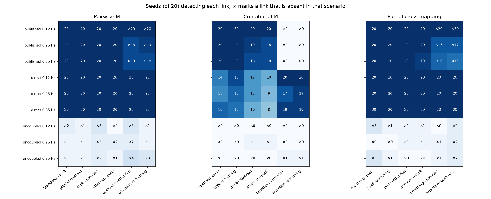

## Power curves

Detection rate against the coupling coefficient of that link, with every other link at zero. All three methods pass 80% at 0.45 on every link except conditional M on pupil→attention, which gets there at 0.60. Pairwise M is slightly more sensitive at weak coupling (0.15–0.30), which is the usual price of conditioning.

### breathing→pupil

| Coupling | Pairwise M | Conditional M | Partial cross mapping |
| --- | --- | --- | --- |
| 0 | 0/20  0.00 (0.00–0.16) | 1/20  0.05 (0.01–0.24) | 1/20  0.05 (0.01–0.24) |
| 0.15 | 6/20  0.30 (0.15–0.52) | 3/20  0.15 (0.05–0.36) | 1/20  0.05 (0.01–0.24) |
| 0.30 | 14/20  0.70 (0.48–0.85) | 12/20  0.60 (0.39–0.78) | 13/20  0.65 (0.43–0.82) |
| 0.45 | 19/20  0.95 (0.76–0.99) | 19/20  0.95 (0.76–0.99) | 20/20  1.00 (0.84–1.00) |
| 0.60 | 20/20  1.00 (0.84–1.00) | 20/20  1.00 (0.84–1.00) | 20/20  1.00 (0.84–1.00) |
| 0.75 | 20/20  1.00 (0.84–1.00) | 20/20  1.00 (0.84–1.00) | 20/20  1.00 (0.84–1.00) |
| 0.90 | 20/20  1.00 (0.84–1.00) | 20/20  1.00 (0.84–1.00) | 20/20  1.00 (0.84–1.00) |

### pupil→breathing

| Coupling | Pairwise M | Conditional M | Partial cross mapping |
| --- | --- | --- | --- |
| 0 | 0/20  0.00 (0.00–0.16) | 0/20  0.00 (0.00–0.16) | 0/20  0.00 (0.00–0.16) |
| 0.15 | 5/20  0.25 (0.11–0.47) | 5/20  0.25 (0.11–0.47) | 1/20  0.05 (0.01–0.24) |
| 0.30 | 13/20  0.65 (0.43–0.82) | 9/20  0.45 (0.26–0.66) | 11/20  0.55 (0.34–0.74) |
| 0.45 | 20/20  1.00 (0.84–1.00) | 20/20  1.00 (0.84–1.00) | 20/20  1.00 (0.84–1.00) |
| 0.60 | 20/20  1.00 (0.84–1.00) | 20/20  1.00 (0.84–1.00) | 20/20  1.00 (0.84–1.00) |
| 0.75 | 20/20  1.00 (0.84–1.00) | 20/20  1.00 (0.84–1.00) | 20/20  1.00 (0.84–1.00) |
| 0.90 | 20/20  1.00 (0.84–1.00) | 20/20  1.00 (0.84–1.00) | 20/20  1.00 (0.84–1.00) |

### pupil→attention

| Coupling | Pairwise M | Conditional M | Partial cross mapping |
| --- | --- | --- | --- |
| 0 | 2/20  0.10 (0.03–0.30) | 0/20  0.00 (0.00–0.16) | 0/20  0.00 (0.00–0.16) |
| 0.15 | 6/20  0.30 (0.15–0.52) | 1/20  0.05 (0.01–0.24) | 3/20  0.15 (0.05–0.36) |
| 0.30 | 10/20  0.50 (0.30–0.70) | 8/20  0.40 (0.22–0.61) | 12/20  0.60 (0.39–0.78) |
| 0.45 | 18/20  0.90 (0.70–0.97) | 15/20  0.75 (0.53–0.89) | 18/20  0.90 (0.70–0.97) |
| 0.60 | 20/20  1.00 (0.84–1.00) | 20/20  1.00 (0.84–1.00) | 20/20  1.00 (0.84–1.00) |
| 0.75 | 20/20  1.00 (0.84–1.00) | 20/20  1.00 (0.84–1.00) | 20/20  1.00 (0.84–1.00) |
| 0.90 | 20/20  1.00 (0.84–1.00) | 20/20  1.00 (0.84–1.00) | 20/20  1.00 (0.84–1.00) |

### attention→pupil

| Coupling | Pairwise M | Conditional M | Partial cross mapping |
| --- | --- | --- | --- |
| 0 | 1/20  0.05 (0.01–0.24) | 1/20  0.05 (0.01–0.24) | 2/20  0.10 (0.03–0.30) |
| 0.15 | 6/20  0.30 (0.15–0.52) | 3/20  0.15 (0.05–0.36) | 4/20  0.20 (0.08–0.42) |
| 0.30 | 13/20  0.65 (0.43–0.82) | 7/20  0.35 (0.18–0.57) | 11/20  0.55 (0.34–0.74) |
| 0.45 | 19/20  0.95 (0.76–0.99) | 17/20  0.85 (0.64–0.95) | 19/20  0.95 (0.76–0.99) |
| 0.60 | 20/20  1.00 (0.84–1.00) | 19/20  0.95 (0.76–0.99) | 20/20  1.00 (0.84–1.00) |
| 0.75 | 20/20  1.00 (0.84–1.00) | 20/20  1.00 (0.84–1.00) | 20/20  1.00 (0.84–1.00) |
| 0.90 | 20/20  1.00 (0.84–1.00) | 20/20  1.00 (0.84–1.00) | 20/20  1.00 (0.84–1.00) |

### breathing→attention

| Coupling | Pairwise M | Conditional M | Partial cross mapping |
| --- | --- | --- | --- |
| 0 | 2/20  0.10 (0.03–0.30) | 0/20  0.00 (0.00–0.16) | 1/20  0.05 (0.01–0.24) |
| 0.15 | 4/20  0.20 (0.08–0.42) | 2/20  0.10 (0.03–0.30) | 4/20  0.20 (0.08–0.42) |
| 0.30 | 14/20  0.70 (0.48–0.85) | 11/20  0.55 (0.34–0.74) | 13/20  0.65 (0.43–0.82) |
| 0.45 | 19/20  0.95 (0.76–0.99) | 19/20  0.95 (0.76–0.99) | 20/20  1.00 (0.84–1.00) |
| 0.60 | 20/20  1.00 (0.84–1.00) | 20/20  1.00 (0.84–1.00) | 20/20  1.00 (0.84–1.00) |
| 0.75 | 20/20  1.00 (0.84–1.00) | 20/20  1.00 (0.84–1.00) | 20/20  1.00 (0.84–1.00) |
| 0.90 | 20/20  1.00 (0.84–1.00) | 20/20  1.00 (0.84–1.00) | 20/20  1.00 (0.84–1.00) |

### attention→breathing

| Coupling | Pairwise M | Conditional M | Partial cross mapping |
| --- | --- | --- | --- |
| 0 | 1/20  0.05 (0.01–0.24) | 0/20  0.00 (0.00–0.16) | 1/20  0.05 (0.01–0.24) |
| 0.15 | 6/20  0.30 (0.15–0.52) | 3/20  0.15 (0.05–0.36) | 3/20  0.15 (0.05–0.36) |
| 0.30 | 15/20  0.75 (0.53–0.89) | 14/20  0.70 (0.48–0.85) | 15/20  0.75 (0.53–0.89) |
| 0.45 | 17/20  0.85 (0.64–0.95) | 19/20  0.95 (0.76–0.99) | 20/20  1.00 (0.84–1.00) |
| 0.60 | 20/20  1.00 (0.84–1.00) | 20/20  1.00 (0.84–1.00) | 20/20  1.00 (0.84–1.00) |
| 0.75 | 20/20  1.00 (0.84–1.00) | 20/20  1.00 (0.84–1.00) | 20/20  1.00 (0.84–1.00) |
| 0.90 | 20/20  1.00 (0.84–1.00) | 20/20  1.00 (0.84–1.00) | 20/20  1.00 (0.84–1.00) |

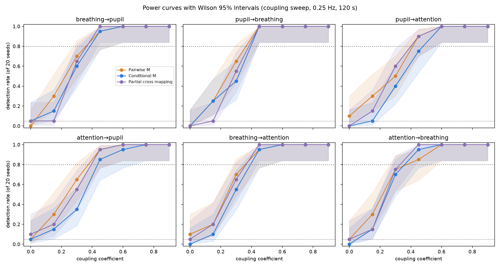

## Where the false positives come from

| Coupling | Pairwise M | Conditional M | Partial cross mapping |
| --- | --- | --- | --- |
| 0 | 36/720 (5%) | 12/720 (2%) | 30/720 (4%) |
| 0.15 | 80/600 (13%) | 45/600 (8%) | 56/600 (9%) |
| 0.30 | 142/600 (24%) | 77/600 (13%) | 108/600 (18%) |
| 0.45 | 160/600 (27%) | 115/600 (19%) | 146/600 (24%) |
| 0.60 | 152/600 (25%) | 130/600 (22%) | 153/600 (26%) |
| 0.75 | 147/600 (25%) | 123/600 (21%) | 144/600 (24%) |
| 0.90 | 148/600 (25%) | 124/600 (21%) | 145/600 (24%) |

False-positive rate on absent links in the sweep, against the strength of the one link that is on. It grows with the coupling and levels off around 20–27%.

| Absent link, relative to the coupled one | Pairwise M | Conditional M | Partial cross mapping |
| --- | --- | --- | --- |
| Reverse of the coupled link | 0.85 (0.83–0.88) | 0.77 (0.74–0.80) | 0.80 (0.77–0.83) |
| Starts where the coupled link ends | 0.10 (0.08–0.13) | 0.04 (0.02–0.05) | 0.07 (0.06–0.10) |
| Same target as the coupled link | 0.10 (0.08–0.12) | 0.02 (0.01–0.04) | 0.09 (0.07–0.11) |
| Same source as the coupled link | 0.05 (0.04–0.07) | 0.01 (0.01–0.03) | 0.04 (0.03–0.06) |
| Ends where the coupled link starts | 0.05 (0.04–0.07) | 0.01 (0.00–0.02) | 0.04 (0.03–0.05) |

> **The sweep false positives are almost all reversed direction.**
>
> When only one link is on, all three methods report the opposite direction as well on 77–85% of tests (720 per method, coupling above zero). Every other absent link stays near the 5% chance level, and conditional M keeps them at 1–4%. So the sweep false-positive rates of 0.15–0.20 are mostly a failure to tell direction once one oscillator locks to another, not invented links between unconnected signals.

## Receiver operating characteristic

True-positive rate (vertical) against false-positive rate (horizontal) when each test is scored by its raw index value instead of the surrogate test. In the scenarios all three rank present links far above absent ones (areas 0.976–0.995). That pairwise M has an area of 0.99 yet a false-positive rate of 0.30 says its index does separate direct from indirect links here, but the time-shift surrogate threshold sits too low to use that. This is an in-sample observation and would need a held-out check before relying on a fixed cut-off. In the sweep the three curves overlap (areas 0.84–0.86), again because reversed-direction tests score as high as true ones.

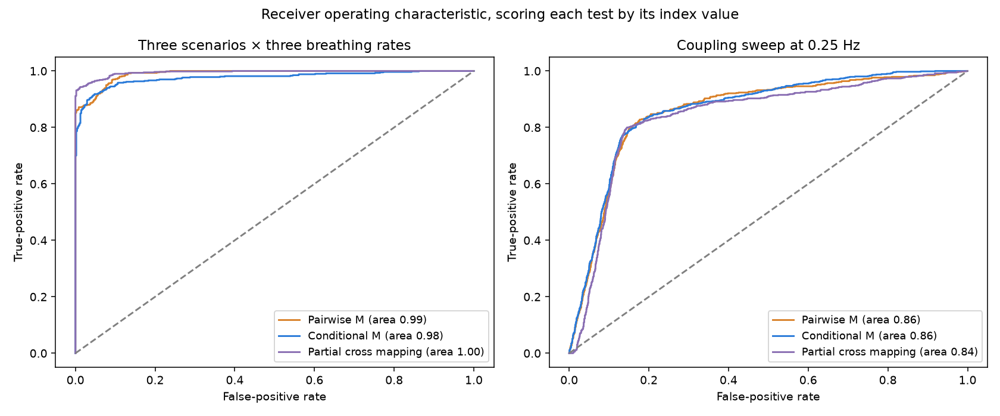

## Index and p-value distributions

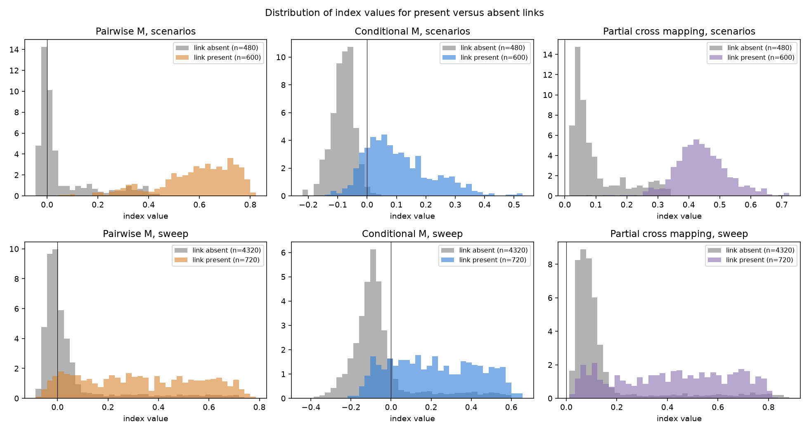

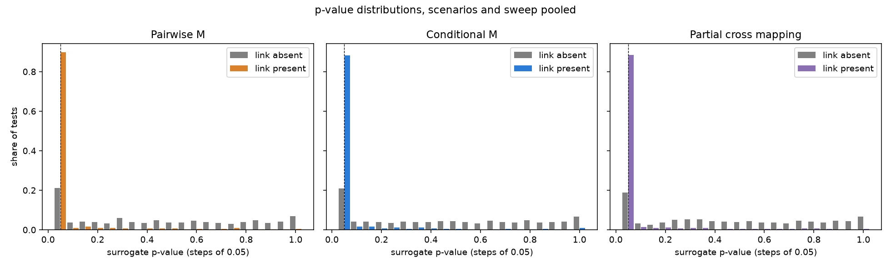

With 19 surrogates the p-value moves in steps of 0.05, and 0.05 means the real index beat every surrogate. About 88–90% of present-link tests sit at that floor for every method, and 19–21% of absent-link tests do too, mostly the reversed-direction cases. The conditional index sits mostly below zero for absent links, which is why the rule also requires a positive index.

## Why pupil to attention is the weak link: frequency swap test

Conditional M found the pupil–attention links less often than the pupil–breathing links, mostly when all six links were on. The model is star-shaped and symmetric in structure: breathing and attention each couple both ways with the locus coeruleus, with one shared coupling strength per run. What is not symmetric is the natural frequencies in `model.simulate_oscillators`. The locus coeruleus runs 0.03 Hz below breathing and attention runs 0.04 Hz above it, so attention sits 0.07 Hz from the locus coeruleus while breathing sits only 0.03 Hz away. The test swaps those gaps and checks whether the weak spot follows.

| Condition | Value |
| --- | --- |
| **Baseline** | Locus coeruleus at breathing − 0.03 Hz, attention at breathing + 0.04 Hz. Gaps from the locus coeruleus: breathing 0.03 Hz, attention 0.07 Hz. Breathing to attention 0.04 Hz. |
| **Swapped** | Locus coeruleus at breathing − 0.07 Hz, attention at breathing − 0.04 Hz. Gaps from the locus coeruleus: breathing 0.07 Hz, attention 0.03 Hz. Breathing to attention stays 0.04 Hz, so this is an exact mirror of the baseline. |
| **Symmetric** | Locus coeruleus at breathing − 0.05 Hz, attention at breathing − 0.10 Hz, so breathing and attention are each 0.05 Hz from the locus coeruleus, on opposite sides. Breathing to attention becomes 0.10 Hz. |
| **Everything else** | Breathing frequency kept at 0.12, 0.25 and 0.35 Hz so the coupling values and embedding are unchanged; published, all-six-links and uncoupled scenarios; seeds 0–19; 19 time-shift surrogates; p ≤ 0.05; phase noise 0.55 |

> **Yes, the weak spot moves with the frequency gaps.**
>
> With all six links on, whichever pair has the largest natural-frequency gap is the one conditional M struggles with. Swapping the gaps moves the weakness from pupil–attention to pupil–breathing, almost as a mirror image, and the symmetric setting moves it to the direct breathing–attention link. With all six links on, pairwise M and partial cross mapping found every link in all 20 seeds in every condition, so all of this loss comes from conditioning.

### All six links on: conditional M detections, three breathing rates pooled

| Link | Baseline | Swapped | Symmetric |
| --- | --- | --- | --- |
| breathing→pupil | 43/60  0.72 (0.59–0.81)  gap 0.03 Hz | 29/60  0.48 (0.36–0.61)  gap 0.07 Hz | 53/60  0.88 (0.78–0.94)  gap 0.05 Hz |
| pupil→breathing | 49/60  0.82 (0.70–0.89)  gap 0.03 Hz | 29/60  0.48 (0.36–0.61)  gap 0.07 Hz | 53/60  0.88 (0.78–0.94)  gap 0.05 Hz |
| pupil→attention | 34/60  0.57 (0.44–0.68)  gap 0.07 Hz | 49/60  0.82 (0.70–0.89)  gap 0.03 Hz | 53/60  0.88 (0.78–0.94)  gap 0.05 Hz |
| attention→pupil | 27/60  0.45 (0.33–0.58)  gap 0.07 Hz | 43/60  0.72 (0.59–0.81)  gap 0.03 Hz | 52/60  0.87 (0.76–0.93)  gap 0.05 Hz |
| breathing→attention | 56/60  0.93 (0.84–0.97)  gap 0.04 Hz | 58/60  0.97 (0.89–0.99)  gap 0.04 Hz | 25/60  0.42 (0.30–0.54)  gap 0.10 Hz |
| attention→breathing | 58/60  0.97 (0.89–0.99)  gap 0.04 Hz | 51/60  0.85 (0.74–0.92)  gap 0.04 Hz | 26/60  0.43 (0.32–0.56)  gap 0.10 Hz |

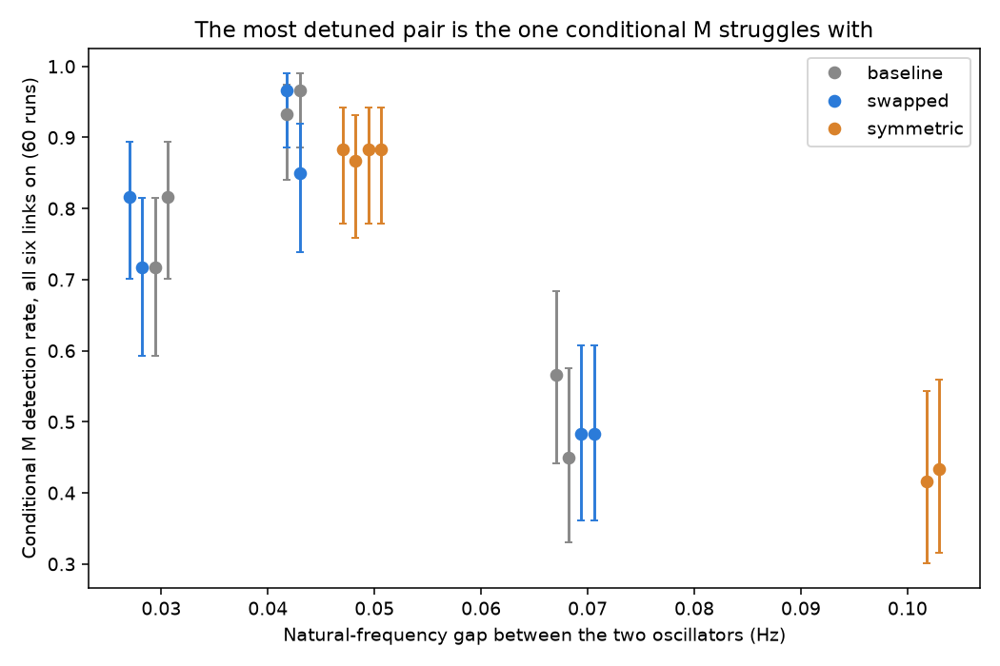

In the baseline, pupil→attention and attention→pupil are found in 34 and 27 of 60 runs, against 43 and 49 for breathing→pupil and pupil→breathing. In the swapped condition those numbers almost exactly trade places: pupil–attention rises to 49 and 43, and pupil–breathing falls to 29 and 29. In the symmetric condition all four locus coeruleus links sit at 52–53 of 60, and the direct breathing–attention link, now the most detuned pair at 0.10 Hz, drops from 56–58 to 25–26.

### Per breathing rate

| Link | All six: baseline | All six: swapped | All six: symmetric | Published: baseline | Published: swapped | Published: symmetric |
| --- | --- | --- | --- | --- | --- | --- |
| breathing→pupil | 14 / 13 / 16 | 10 / 9 / 10 | 19 / 16 / 18 | 20 / 20 / 20 | 20 / 19 / 19 | 20 / 20 / 20 |
| pupil→breathing | 18 / 16 / 15 | 9 / 10 / 10 | 20 / 16 / 17 | 20 / 20 / 20 | 20 / 19 / 20 | 20 / 20 / 20 |
| pupil→attention | 12 / 12 / 10 | 15 / 17 / 17 | 19 / 17 / 17 | 20 / 19 / 18 | 20 / 20 / 20 | 20 / 19 / 20 |
| attention→pupil | 10 / 9 / 8 | 14 / 14 / 15 | 19 / 16 / 17 | 20 / 18 / 18 | 20 / 20 / 20 | 20 / 19 / 20 |
| breathing→attention | 20 / 17 / 19 | 20 / 19 / 19 | 8 / 7 / 10 | absent | absent | absent |
| attention→breathing | 20 / 19 / 19 | 20 / 16 / 15 | 10 / 9 / 7 | absent | absent | absent |

Seeds out of 20 detected by conditional M at 0.12 / 0.25 / 0.35 Hz breathing. In the published model the effect is small because detection is near the ceiling, but it points the same way: the baseline misses a few pupil–attention runs and the swapped condition misses a few pupil–breathing runs instead. In the uncoupled scenario conditional M stayed at 0–2 of 20 per link in every condition, and pairwise M at 0–5 of 20.

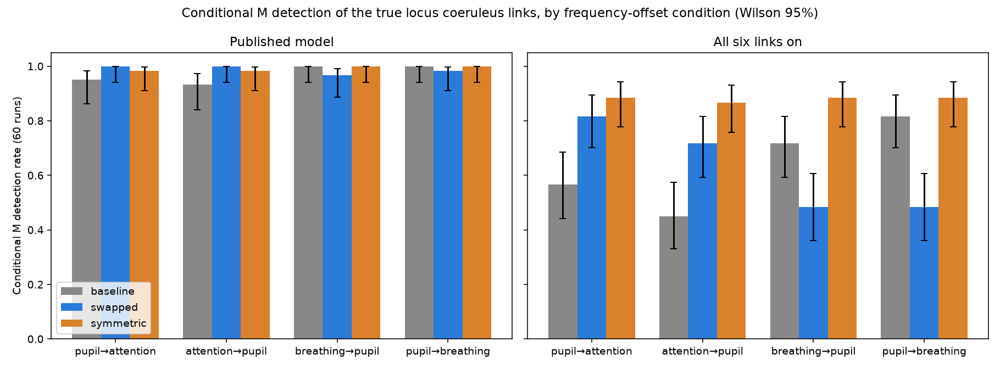

### One link on at a time

| Link | Baseline | Swapped | Symmetric |
| --- | --- | --- | --- |
| breathing→pupil | 12 / 19 / 20  (locking 0.54) | 7 / 16 / 20  (locking 0.40) | 7 / 18 / 19  (locking 0.47) |
| pupil→breathing | 9 / 20 / 20  (locking 0.54) | 4 / 13 / 19  (locking 0.40) | 9 / 16 / 19  (locking 0.47) |
| pupil→attention | 8 / 15 / 20  (locking 0.44) | 11 / 19 / 20  (locking 0.55) | 9 / 19 / 20  (locking 0.46) |
| attention→pupil | 7 / 17 / 19  (locking 0.44) | 13 / 16 / 20  (locking 0.55) | 8 / 14 / 18  (locking 0.46) |

A smaller sweep at 0.25 Hz with 120 s recordings: conditional M detections out of 20 at coupling 0.30 / 0.45 / 0.60, with only that link switched on, and the pair's mean phase-locking value at 0.45 in brackets. Here the detuned pair also locks less tightly, and detection follows. In the baseline pupil→attention reaches 15 of 20 at 0.45. In the swapped condition it reaches 19 while pupil→breathing falls to 13.

### Phase locking

| Pair | Published: baseline | Published: swapped | Published: symmetric | All six: baseline | All six: swapped | All six: symmetric |
| --- | --- | --- | --- | --- | --- | --- |
| Pupil–attention | 0.61 | 0.73 | 0.60 | 0.80 | 0.82 | 0.80 |
| Pupil–breathing | 0.73 | 0.64 | 0.62 | 0.82 | 0.81 | 0.80 |
| Breathing–attention | 0.45 | 0.47 | 0.35 | 0.82 | 0.83 | 0.77 |

The phase-locking value is the length of the average of the unit vectors pointing along the phase difference between two oscillators, computed from the model's true phases. It is 1 when the phase difference never changes and near 0 when there is no consistent relation. Values are averaged over seeds and the three breathing rates, and the uncoupled scenario sits at 0.04–0.15.

In the published model, the pair with the bigger gap locks less tightly, and the swap reverses that (pupil–attention 0.62 against pupil–breathing 0.73 in the baseline, 0.73 against 0.64 when swapped). With all six links on, though, every pair locks at 0.77–0.83. The weak pair is the least locked by only 0.02–0.03, yet its detection rate is 15–50 percentage points lower than the other links in the same condition. So in the all-six-links case the frequency gap predicts the weak spot much better than how tightly the pair locks.

### What this means and what to keep in mind

- The pupil–attention weakness is not about attention or the locus coeruleus as such. It comes from the uneven natural-frequency offsets that were chosen for the simulation, and it moves when they move.
- A likely reading, which I have not tested further, is this: when the two oscillators that are furthest apart in frequency are held together, much of that is done by the other two routes, so once the third signal is conditioned on there is less left that only the direct link explains.
- This matters for your direct breathing–cortex question. In the symmetric setting the direct breathing–attention link was found in only 25–26 of 60 runs, so on real data a missed direct link could reflect how far apart the rhythms are, not that the link is absent.
- Keeping breathing fixed means the locus coeruleus and attention frequencies changed. At 0.12 Hz breathing, the swapped condition puts the locus coeruleus at 0.05 Hz and the symmetric condition puts attention at 0.02 Hz. The embedding delay is still set from the breathing frequency.
- Each cell has 20 seeds, or 60 when the breathing rates are pooled, so differences of a few seeds fall inside the Wilson intervals. The baseline rerun matched the earlier results seed for seed.
- Files: /workspace/nlid_performance/frequency_swap/ on my computer (counts, phase locking, the sweep and two charts). Nothing was pushed to the repository.

## Telling direction: the joint-embedding forecast (prediction gain)

> **Yes, it tells direction far better, at a cost in sensitivity.**
>
> In the single-link sweep, prediction gain flagged the reverse of the coupled link in 44 of 720 tests (6%), against 77–85% for conditional M, pairwise M and partial cross mapping. It found the true link in 67% of tests against 76–81% for the others. In the three scenarios it found only 56% of present links, against 83% for conditional M, so it is a direction check rather than a replacement.

### What the joint embedding is

Each signal is still reconstructed with its own Takens delay embedding: three samples a quarter of a breathing cycle apart, so a three-dimensional trajectory per signal. The joint embedding simply places the target's three numbers and the conditioning signal's three numbers side by side, so each moment becomes one point in six dimensions. Each block is scaled first so neither signal dominates the distance. Two moments are neighbours in this space only if both the target and the third signal were in similar states at the same time.

Prediction gain then asks a forecasting question rather than a matching question. For each moment it takes the 40 nearest neighbours in that six-dimensional space. The baseline forecast is the average of what the target's own sample did h steps later at the 8 closest of them. The refined forecast re-ranks the same 40 by how close the source's three-dimensional state is and averages the target's future over the best 8. The gain is 1 minus the refined forecast error divided by the baseline forecast error, so 0 means the source adds nothing and positive means it improves the forecast. The branch default tries horizons of 0.1, 0.2, 0.4, 0.8 and 1.2 s and keeps the best, and each surrogate is scored the same way, so picking the best horizon does not by itself make it easier to pass the test.

The difference from conditional M is the arrow of time. Conditional M asks whether the source's present state picks out moments when the target's present state is similar, which works equally well in both directions once two oscillators lock. Prediction gain asks whether the source's present helps predict the target's future beyond what the target and third signal already say, much like Granger causality, and that is not symmetric.

### Single-link sweep at 0.25 Hz

| Method | Sensitivity (link on) | Reverse direction flagged | Other absent links flagged | All couplings zero, flagged |
| --- | --- | --- | --- | --- |
| Pairwise M | 0.81 (0.78–0.84) | 0.85 (0.83–0.88) | 0.07 (0.07–0.08) | 0.05 (0.04–0.07) |
| Conditional M | 0.76 (0.73–0.79) | 0.77 (0.74–0.80) | 0.02 (0.02–0.03) | 0.02 (0.01–0.03) |
| Partial cross mapping | 0.79 (0.76–0.82) | 0.80 (0.77–0.83) | 0.06 (0.05–0.07) | 0.04 (0.03–0.06) |
| Prediction gain (branch default) | 0.67 (0.64–0.70) | 0.06 (0.05–0.08) | 0.05 (0.04–0.06) | 0.06 (0.04–0.08) |

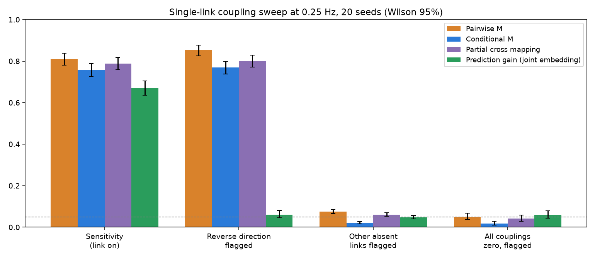

Couplings above zero only, except the last column. The reverse-direction rate for prediction gain stays between 4 and 10 of 120 at every coupling from 0.15 to 0.90, while conditional M climbs from 25 to 120 of 120. Prediction gain needs more coupling to see a link: it reaches 80% detection at 0.45 for breathing→pupil and attention→breathing, and at 0.60 for the other four. At 0.45 it finds 11–18 of 20 per link, against 15–20 for the other methods. Its all-zero rate of 5.8% sits at the expected 5%, and its other-absent rate of 4.8% is between conditional M's 2.1% and pairwise M's 7.5%.

### Forecast horizon

| Horizon | Sensitivity | Reverse flagged | Other absent flagged | All zero flagged |
| --- | --- | --- | --- | --- |
| 0.1 s | 0.00 (0.00–0.01) | 0.00 (0.00–0.01) | 0.00 (0.00–0.00) | 0.00 (0.00–0.01) |
| 0.2 s | 0.08 (0.07–0.11) | 0.00 (0.00–0.01) | 0.00 (0.00–0.00) | 0.00 (0.00–0.01) |
| 0.4 s | 0.45 (0.42–0.49) | 0.00 (0.00–0.01) | 0.00 (0.00–0.01) | 0.00 (0.00–0.01) |
| 0.8 s | 0.65 (0.62–0.69) | 0.05 (0.03–0.07) | 0.03 (0.02–0.03) | 0.04 (0.03–0.06) |
| 1.2 s | 0.64 (0.61–0.68) | 0.05 (0.04–0.07) | 0.04 (0.04–0.05) | 0.07 (0.05–0.09) |
| 2.0 s | 0.68 (0.65–0.71) | 0.07 (0.06–0.10) | 0.07 (0.06–0.08) | 0.10 (0.08–0.12) |
| 4.0 s | 0.58 (0.55–0.62) | 0.12 (0.10–0.15) | 0.10 (0.09–0.11) | 0.14 (0.12–0.17) |
| Best of 0.1–1.2 s (default) | 0.67 (0.64–0.70) | 0.06 (0.05–0.08) | 0.05 (0.04–0.06) | 0.06 (0.04–0.08) |

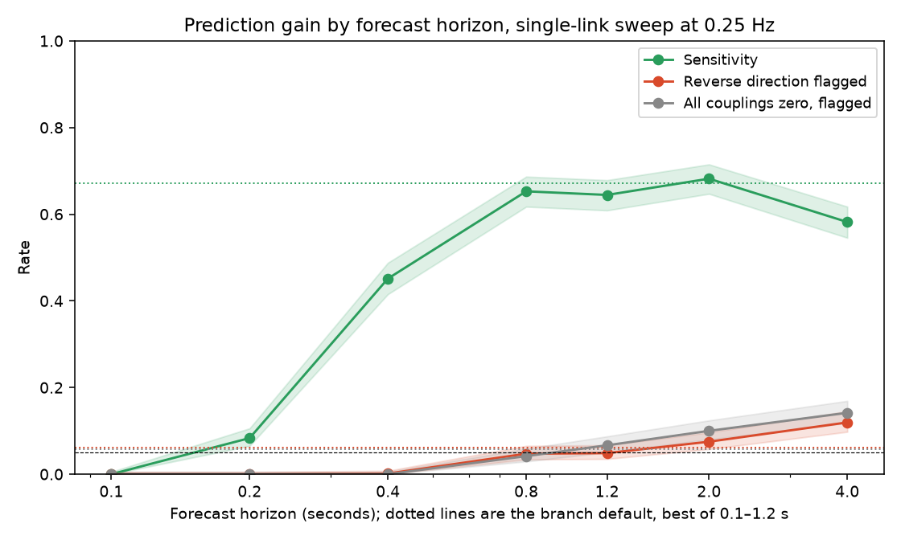

I ran every horizon in the branch default on its own, plus 2.0 and 4.0 s, and report all of them; none was tuned. Very short horizons see nothing, because a tenth of a second ahead a slow oscillation is already fully predicted by its own state. From 0.8 to 2.0 s the sensitivity levels off at 64–68% and falls to 58% at 4.0 s, while false positives sit around 3–7% at 0.8–1.2 s and climb beyond that (10% all-zero at 2.0 s, 14% at 4.0 s). 0.4 s is the cautious extreme: almost no false positives of any kind, but only 45% sensitivity. In the scenarios the default chose 1.2 s in 751 of 1,080 tests, 0.8 s in 284 and 0.4 s in 45.

### Three scenarios, baseline offsets

| Method | Sensitivity, all present | Published, present | All six on | Absent flagged | Published breathing–attention flagged | Uncoupled flagged |
| --- | --- | --- | --- | --- | --- | --- |
| Pairwise M | 1.00 (0.99–1.00) | 1.00 (0.98–1.00) | 1.00 (0.99–1.00) | 0.30 (0.26–0.34) | 0.94 (0.88–0.97) | 0.09 (0.06–0.12) |
| Conditional M | 0.83 (0.80–0.86) | 0.97 (0.94–0.99) | 0.74 (0.69–0.78) | 0.01 (0.00–0.02) | 0.00 (0.00–0.03) | 0.01 (0.00–0.03) |
| Partial cross mapping | 1.00 (0.99–1.00) | 1.00 (0.98–1.00) | 1.00 (0.99–1.00) | 0.26 (0.22–0.30) | 0.88 (0.80–0.92) | 0.06 (0.04–0.08) |
| Prediction gain (default) | 0.56 (0.52–0.59) | 0.55 (0.49–0.61) | 0.56 (0.51–0.61) | 0.03 (0.02–0.05) | 0.03 (0.01–0.07) | 0.03 (0.02–0.06) |

Prediction gain keeps false positives low (3% of absent tests) but misses many real links. Its sensitivity depends strongly on the breathing rate: at 0.12 Hz it finds 14–19 of 20 per present link, at 0.25 and 0.35 Hz only 2–12. I have not separated why. The 0.12 Hz runs are longer (417 s against 180–200 s) and use a stronger coupling (0.45 against 0.33), and either could be the reason.

### The pupil–attention weak spot

| All six links on, both directions pooled | Pupil–attention | Pupil–breathing | Breathing–attention |
| --- | --- | --- | --- |
| Conditional M, baseline | 0.51 (0.42–0.60) | 0.77 (0.68–0.83) | 0.95 (0.90–0.98) |
| Conditional M, swapped | 0.77 (0.68–0.83) | 0.48 (0.40–0.57) | 0.91 (0.84–0.95) |
| Conditional M, symmetric | 0.88 (0.80–0.92) | 0.88 (0.81–0.93) | 0.42 (0.34–0.51) |
| Prediction gain, baseline | 0.52 (0.43–0.60) | 0.61 (0.52–0.69) | 0.55 (0.46–0.64) |
| Prediction gain, swapped | 0.57 (0.48–0.65) | 0.55 (0.46–0.64) | 0.62 (0.53–0.70) |
| Prediction gain, symmetric | 0.56 (0.47–0.64) | 0.53 (0.44–0.62) | 0.48 (0.40–0.57) |

Prediction gain does not have the frequency-gap weak spot: it finds every pair at a similar rate of 48–61% in all three frequency conditions. But that rate is no better than conditional M's weak pair, so it does not rescue pupil–attention; it is uniformly modest. In the smaller swapped and symmetric sweeps (four locus coeruleus links, couplings 0.30–0.60, 240 tests each), its reverse-direction rate stayed at 14, 14 and 6 of 240 for baseline, swapped and symmetric, against 178–189 of 240 for conditional M, so the direction result does not depend on the frequency offsets.

### What this suggests

- Use the two measures together: conditional M (or pairwise M) to say whether two signals are linked, and prediction gain to say which way. A link both find points in the direction prediction gain supports.
- Expect prediction gain to miss weak links, especially in short recordings; a missing prediction gain result is weak evidence of absence.
- The horizon results were not tuned. The branch default (best of 0.1–1.2 s) is a reasonable middle; 0.4 s is the conservative choice if false positives matter most.
- Raw results and tables are in /workspace/nlid_performance/joint_embedding/ on my computer. The computation reproduces the branch's own prediction gain values exactly; nothing was pushed.

## Full joint-embedding forecast (nine dimensions)

### What changed from the branch version

The branch prediction gain finds neighbours in the six-dimensional space of the target and the conditioner, and only then lets the source re-rank them. The full version puts all three signals into one space from the start: three delay coordinates each for target, conditioner and source, each block standardised, nine dimensions in all. The forecast of the target h steps ahead is the average of what the target did after its 8 nearest neighbours (with the same Theiler window, which excludes neighbours that are just the same stretch of time). The reduced forecast does the same in the six-dimensional space without the source. Full prediction gain is one minus the full forecast error divided by the reduced forecast error, so it is positive when knowing the source's state makes the target's future easier to predict. Horizons were 0.1, 0.2, 0.4, 0.8 and 1.2 s; the best of the five was compared with the best of the five on each surrogate, and 0.4 s was also scored alone. Surrogates shift the source only, exactly as before.

### Single-link sweep at 0.25 Hz

| Method | Sensitivity (link on) | Reverse direction flagged | Other absent links flagged | All couplings zero, flagged |
| --- | --- | --- | --- | --- |
| Pairwise M | 0.81 (0.78–0.84) | 0.85 (0.83–0.88) | 0.07 (0.07–0.08) | 0.05 (0.04–0.07) |
| Conditional M | 0.76 (0.73–0.79) | 0.77 (0.74–0.80) | 0.02 (0.02–0.03) | 0.02 (0.01–0.03) |
| Partial cross mapping | 0.79 (0.76–0.82) | 0.80 (0.77–0.83) | 0.06 (0.05–0.07) | 0.04 (0.03–0.06) |
| Branch prediction gain, best of 5 | 0.67 (0.64–0.70) | 0.06 (0.05–0.08) | 0.05 (0.04–0.06) | 0.06 (0.04–0.08) |
| Full prediction gain, best of 5 | 0.65 (0.61–0.68) | 0.07 (0.05–0.09) | 0.05 (0.05–0.06) | 0.04 (0.03–0.06) |
| Full prediction gain, 0.4 s | 0.43 (0.39–0.46) | 0.00 (0.00–0.01) | 0.00 (0.00–0.01) | 0.00 (0.00–0.01) |
| Bayesian coupling strength | 0.73 (0.70–0.76) | 0.33 (0.29–0.36) | 0.15 (0.14–0.16) | 0.03 (0.02–0.04) |

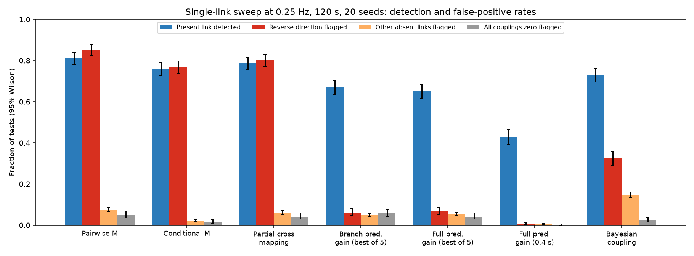

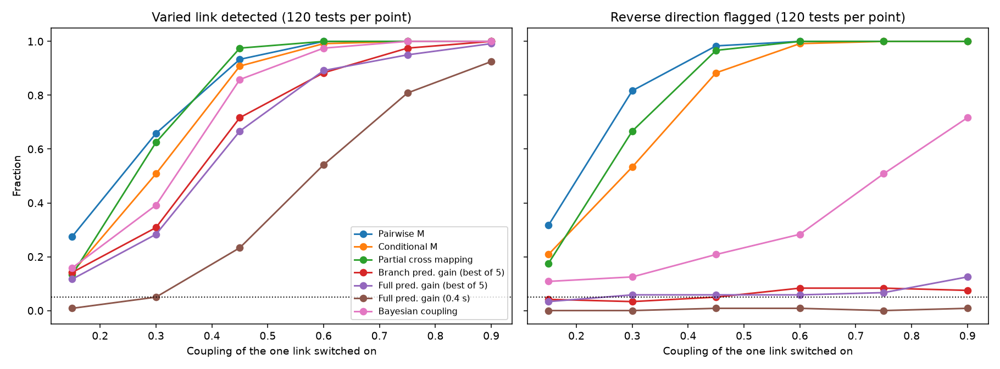

The full nine-dimensional forecast behaves almost exactly like the branch version: sensitivity 65% against 67%, reverse direction 7% against 6%. Putting the source in the space from the start did not buy anything. At the fixed 0.4 s horizon it is the most conservative measure on this page (3 reverse flags in 720, none when every coupling is zero) but it finds only 43% of real links, and 23% at coupling 0.45.

One thing I saw while checking single runs: the full-space forecast is often worse than the reduced one (negative gain), because three extra source dimensions dilute the neighbour search. The surrogates make it worse still, so a negative gain can still beat them. The rule that the index must be positive rejects those cases, which is part of why sensitivity is no higher.

### Three scenarios

| Method | Sensitivity, all present | Absent flagged | Published breathing–attention flagged | Uncoupled flagged | All six on, pupil–attention found |
| --- | --- | --- | --- | --- | --- |
| Conditional M | 0.83 (0.80–0.86) | 0.01 (0.00–0.02) | 0.00 (0.00–0.03) | 0.01 (0.00–0.03) | 0.51 (0.42–0.60) |
| Branch prediction gain, best of 5 | 0.56 (0.52–0.59) | 0.03 (0.02–0.05) | 0.03 (0.01–0.07) | 0.03 (0.02–0.06) | 0.52 (0.43–0.60) |
| Full prediction gain, best of 5 | 0.57 (0.53–0.61) | 0.02 (0.01–0.04) | 0.04 (0.02–0.09) | 0.01 (0.00–0.03) | 0.58 (0.49–0.67) |
| Full prediction gain, 0.4 s | 0.13 (0.11–0.16) | 0.00 (0.00–0.01) | 0.00 (0.00–0.03) | 0.00 (0.00–0.01) | 0.16 (0.10–0.23) |
| Bayesian coupling strength | 0.93 (0.91–0.95) | 0.19 (0.16–0.23) | 0.60 (0.51–0.68) | 0.06 (0.04–0.08) | 0.91 (0.84–0.95) |

By breathing rate, full prediction gain (best of 5) found 162 of 200 present links at 0.12 Hz, 91 at 0.25 Hz and 87 at 0.35 Hz. The pupil–attention pair is no weaker than the others for it (70 of 120, against 75 for pupil–breathing and 70 for breathing–attention), but that is because it is uniformly middling, not because it solves the weak spot. Pairwise M and partial cross mapping find all 120 but also flag the absent link in the published model 113 and 105 times out of 120.

### Is it the recording length or the coupling?

Both forecasts did far better at 0.12 Hz than at 0.25 or 0.35 Hz. But the 0.12 Hz runs differ in two ways: they are longer (417 s against 200 s) and the coupling is stronger (0.45 against 0.33). I reran the 0.25 Hz scenarios four ways, crossing the two lengths with the two couplings, 20 seeds each.

| 0.25 Hz arm | Branch, best of 5 | Full, best of 5 | Branch, 0.4 s | Full, 0.4 s | Absent flagged (branch / full, best of 5) |
| --- | --- | --- | --- | --- | --- |
| 200 s, coupling 0.33 (baseline) | 0.39 (0.33–0.46) | 0.46 (0.39–0.52) | 0.08 (0.05–0.13) | 0.09 (0.06–0.14) | 4 / 2 of 160 |
| 417 s, coupling 0.33 | 0.57 (0.50–0.64) | 0.54 (0.47–0.61) | 0.08 (0.05–0.13) | 0.05 (0.03–0.09) | 0 / 2 of 160 |
| 200 s, coupling 0.45 | 0.66 (0.59–0.72) | 0.71 (0.65–0.77) | 0.20 (0.15–0.26) | 0.28 (0.23–0.35) | 8 / 3 of 160 |
| 417 s, coupling 0.45 | 0.88 (0.83–0.92) | 0.88 (0.82–0.91) | 0.30 (0.24–0.37) | 0.28 (0.22–0.35) | 1 / 3 of 160 |

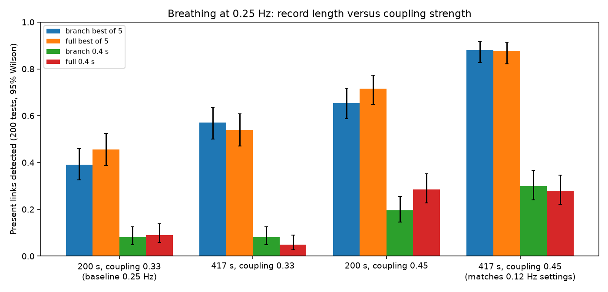

Coupling matters more than length. Raising coupling from 0.33 to 0.45 at 200 s took the branch measure from 39% to 66%; doubling the length at coupling 0.33 took it only to 57%. With both changed (417 s and 0.45, the 0.12 Hz settings) it found 88%, which is the same as at 0.12 Hz (171 of 200). So the low sensitivity at 0.25 and 0.35 Hz comes from the shorter records and weaker coupling used there, not from the breathing rate itself. The baseline arm reproduces the earlier 0.25 Hz numbers exactly (78 and 4), which checks the setup.

## Dynamical Bayesian inference of phase coupling

### What it does, in plain terms

This method (Stankovski, Duggento, McClintock and Stefanovska, Physical Review Letters, 2012) works on phases rather than on reconstructed trajectories. First, each signal is turned into a phase that advances by one full turn per cycle; I used the Hilbert transform, which gives the angle of the signal's rotating analytic version. Second, the method assumes each phase speeds up or slows down according to a smooth function of all three phases plus random noise, which is exactly the form of the 2018 model. It writes that function as a sum of sines and cosines and estimates their weights from the data, together with the noise level, using Bayes' rule. Third, it works in 50 s windows and carries what it learned in one window forward as the starting belief for the next, slightly loosened so the coupling can change over time. The coupling strength from source to target is the size of all the weights in the target's equation that involve the source's phase, averaged over windows.

For significance I made 19 surrogates of the source phase only by cutting it into cycles and shuffling their order (cyclic phase permutation). This keeps the source's own rhythm but breaks its timing relationship with the other two. A link counts as detected when its strength beats all 19 surrogates (p = 0.05).

Implementation: there is no open three-oscillator Python version. PyMODAlib 0.11.3b1 (Lancaster University, GPL-3.0) has a two-oscillator Python translation of the MODA toolbox, which its own source marks as experimental and unfinished. I wrote a three-oscillator version following that code and the paper (bayesian/dbi.py). Settings were fixed in advance: 50 s windows, propagation constant 0.2, Fourier order 1 (sines and cosines of single phases and of sums and differences of pairs). I first tried order 2 as well; it failed numerically in 23 of 60 runs at 0.12 Hz and gave inflated strengths elsewhere, so I dropped it before looking at any detection rates. With order 1 every fit converged.

### Results

The sweep and scenario tables in the section above include it as Bayesian coupling strength. In short: it is the most sensitive of the direction-aware methods (73% of sweep links, 93% of scenario links, and 109 of 120 on the pupil–attention weak spot), but it is poor at telling direction once coupling is strong and it flags the absent breathing–attention link in the published model 72 times out of 120.

| Coupling of the one link on | 0.15 | 0.30 | 0.45 | 0.60 | 0.75 | 0.90 |
| --- | --- | --- | --- | --- | --- | --- |
| Varied link found (of 120) | 19 | 47 | 103 | 117 | 120 | 120 |
| Reverse direction flagged (of 120) | 13 | 15 | 25 | 34 | 61 | 86 |

Its reverse-direction rate (33% overall) is far better than pairwise M, conditional M and partial cross mapping (77–85%) but far worse than either prediction gain (6–7%). When the uncoupled oscillators are tested, it flags 20 of 360 (6%), close to the 5% the test is designed for.

### Why it flags the absent link

To check whether the Hilbert phases were to blame, I reran the published and uncoupled scenarios using the simulator's true phases. The absent breathing–attention link was still flagged 68 times out of 120 (Hilbert phases: 72), while uncoupled runs gave 13 flags in 360. So it is not the phase extraction. The likely cause is the surrogate: in the published model breathing and pupil are locked, so breathing's phase carries pupil's timing, and the fit can use breathing terms to explain attention. Shuffling breathing's cycles destroys that shared timing, the surrogate strengths drop, and the real value looks significant. A surrogate that kept the source's relation to the conditioner would be needed to fix this; I did not try one.

## Caveats and provenance

- The phase noise of 0.55 radians per root second was added to stop the noise-free model collapsing onto one cycle; it is not from the 2018 paper.
- The coupling values come from the iterated simulation in 2018 Figure 5 and are not biological values.
- With 19 surrogates and recordings of 120–417 s, the smallest possible p-value is 0.05, so p-values are coarse and there is no room for multiple-comparison correction inside a test.
- Precision and F1 depend on how many links are present: 600 of 1,080 tests in the scenarios but 720 of 5,040 in the sweep. Compare them within a dataset, not across.
- Areas under the curve pool index values across links and scenarios on one scale, and their intervals are from 2,000 bootstrap resamples, not Wilson intervals.
- All numbers come from a full rerun of the branch code (pull request 1, branch cursor/nonlinear-interdependence-3b6b): 180 scenario runs and 840 sweep cells, about 20 minutes on my computer. The rerun matched the published counts exactly.
- The full prediction gain, length test and Bayesian runs are in /workspace/nlid_performance/joint_full/, bayesian/ and compare/ on my computer (raw per-test results, tables and scripts). Nothing was pushed.
